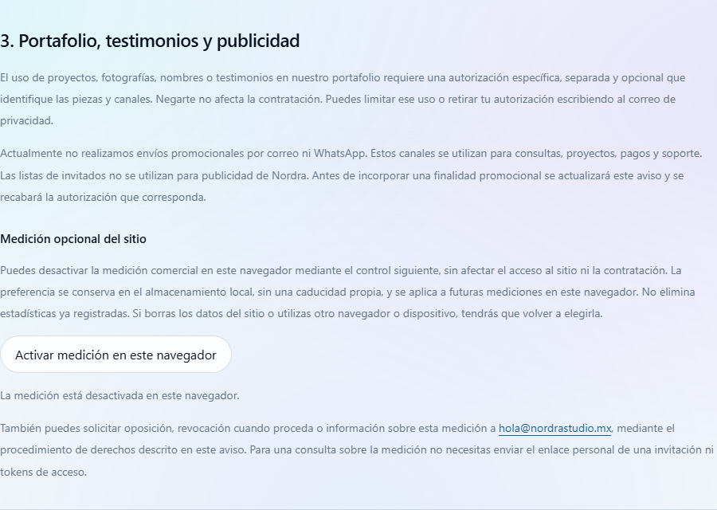

# Analítica comercial · WhatsApp

30/10/2026. Rama local `codex/analitica-whatsapp`, creada tras `git fetch` y avance
rápido de `main` a `origin/main`: ambos en **a65199d**. El hero de paisaje pendiente
de aprobación no forma parte de esta rama. **Sin push ni despliegue.**

## Implementación

- `@vercel/analytics` fijado a **2.0.1**, importado dinámicamente después de load/idle.
  Una activación temprana puede adelantar la carga para conservar el clic.
- Instalación solo en las ocho entradas comerciales. `page` pertenece a
  `index`, `estudio`, `negocios`, `invitaciones`, `bodas`, `cumpleanos`, `eventos`
  o `temporada`. `invitaciones.html` es la página comercial; `/invitaciones/*`
  y las vistas de clientes quedan excluidas.
- Un evento `whatsapp_click`, con exactamente dos propiedades personalizadas:
  `page` y `button`. Botones cerrados: `hero_quote`, `closing`, `plan_aurora`,
  `plan_boreal`, `web_option`, `footer` y `seasonal_design`. Hay 24 enlaces
  identificados en el HTML. No se obtiene el identificador a partir del mensaje,
  teléfono, nombre, texto del usuario ni precio.
- Se aceptan clics reales principales, activación con Enter y clic central;
  se rechazan eventos sintéticos, acciones canceladas y clic derecho. El listener
  no cambia ni retrasa la navegación a WhatsApp.
- `beforeSend` reconstruye la URL canónica sin query ni fragmento y restringe el
  payload del evento. Las páginas usan `no-referrer` para que tampoco se filtre
  su URL con parámetros por la cabecera HTTP. Se descarta la medición si un
  referrer externo trae una ruta privada, consulta o fragmento que el SDK pudiera
  adjuntar por separado. El SDK conserva sus metadatos técnicos estándar; las dos
  propiedades se refieren a los datos personalizados del evento.
- Autotracking desactivado: una vista manual por documento comercial mostrado.
  Los iframes ocultos o precargados no cargan el SDK ni cuentan vistas. El documento
  cubierto por una página de navegación deja de registrar clics; no hay reenvío
  de eventos entre padre e iframe. Atrás/adelante fueron comprobados.
- Sin cookies nuevas, banner, identificación de usuarios ni otros proveedores.
  El aviso incorpora un control de desactivación por navegador. Guarda únicamente
  `nordra-analytics-disabled=true` en localStorage; también afecta a pestañas
  comerciales ya abiertas. Si el almacenamiento no está disponible, la medición
  no se activa. Los derechos existentes por correo se conservan.

La normalización se apoya en `beforeSend`, según la
[documentación de Vercel](https://vercel.com/docs/analytics/redacting-sensitive-data).
El aviso distingue los datos técnicos del proveedor de las propiedades del clic,
siguiendo su [documentación de privacidad](https://vercel.com/docs/analytics/privacy-policy).

## Aviso pendiente de aprobación

**[Texto anterior y propuesto, por apartado](analitica-whatsapp-aviso.md).**

Incluye datos/finalidades, oposición y control local, función analítica de Vercel,
conservación, tecnologías y fecha/versión. La ventana de informes de Pro de 12 meses
no se presenta como garantía de eliminación; ubicación, entidad/DPA y eliminación
aplicables quedan señaladas para confirmación documental. La ventana se contrastó
con los [límites publicados de Vercel](https://vercel.com/docs/analytics/limits-and-pricing).

El aviso vigente en producción no se ha modificado. El texto propuesto está en un
commit independiente y **no se publica hasta la aprobación del responsable**.

## Verificación

- `npm run typecheck`: correcto.
- `npm test`: **126 + 34 pruebas correctas**, más check Posada. Las pruebas
  existentes de tokens, autenticación y privacidad siguen pasando sin relajarlas.
  Se añaden 10 pruebas de alcance, listas cerradas, redacción, activaciones,
  load/idle, iframes, prerender, desactivación y propiedades prohibidas.
- `npm run check:build`: correcto; 15 entradas, verificadores de bundles e inputs.
  Las páginas comerciales conservan una sola hoja CSS compilada.
- **29 casos de navegador**, con toda la red interceptada. Se sirve localmente
  una copia sin modificar del script oficial de Vercel, descargada para la prueba
  el 30/10/2026; se interceptan `/view` y `/event`. No se enviaron datos a Vercel
  ni a WhatsApp. Los destinos se sustituyeron por fixtures en el DOM de prueba.
- Las ocho páginas enviaron la ruta canónica y los dos campos permitidos, incluso
  entrando con un token/fragmento de fixture. Se verificaron todos los enlaces,
  incluidos los 11 dentro de planes desplegados, y teclado en las ocho páginas.
  Se capturaron 33 eventos válidos contando la prueba de reactivación entre pestañas.
  Sin URLs de WhatsApp, mensajes, teléfonos ni parámetros en las peticiones.
- Una sola vista por entrada y por navegación; cero vistas del iframe precargado.
  Secuencia comprobada: Inicio → Negocios → Inicio → atrás → adelante, con cinco
  vistas en total. Sin duplicados del documento padre.
- Cero cargas de SDK y eventos en **14 rutas excluidas**: gestión demo, posada y
  pagos; pago con token de fixture; panel, mi-boda, pase, recepción, invitación
  alternativa, invitación marfil, invitación de posada, demos BRUMA y Posada Luz,
  y aviso de privacidad. `/gestion.html` sin parámetros redirige de forma ya
  existente a Inicio; en ese caso la vista corresponde al nuevo documento Inicio.
- El control de privacidad bloquea futuras vistas/clics, incluso en otra pestaña
  ya abierta, y permite reactivar. No se crearon cookies. Consola sin errores en
  los recorridos comerciales y del aviso; las API de páginas privadas se sustituyen
  por respuestas de prueba y no se usan credenciales reales.

### LCP, tres rondas

Mismo método de `docs/signature-lcp.md`: Chrome 156, 375 × 900, DPR 1, CPU ×4,
10 Mbit/s de bajada, 5 Mbit/s de subida, 40 ms de latencia, caché desactivada,
contexto nuevo, tema claro y movimiento activo. Referencia de a65199d en 5588 y
propuesta en 5589. Orden alternado en la segunda ronda, sin compilaciones ni otros
navegadores de prueba simultáneos; último candidato tras load + 6 s. Toda la red
de analítica está interceptada. Se permite ejecutar el script real en la fixture
headless para verificar su coste y sus peticiones, sin saltarse la instrumentación.

| Página | Antes: rondas | Después: rondas | Mediana antes | Mediana después |
|---|---|---|---:|---:|
| Inicio | 620 / 592 / 588 ms | 540 / 552 / 560 ms | 592 ms | **552 ms** |
| Negocios | 1176 / 1188 / 1120 ms | 1096 / 1108 / 1076 ms | 1176 ms | **1096 ms** |

No se observó regresión en esta muestra local. Estas cifras no garantizan la misma
variación en producción. [Evidencia compacta](analitica-whatsapp/verification.json).
Los scripts y resultados completos se conservan fuera del repositorio en
`E:\Nordra Studio\Revision Signature\2026-10-30-analitica-whatsapp`.

## Commits y estado

- `64854f3`: SDK, instrumentación comercial, normalización y pruebas.
- `cc740b0`: propuesta del aviso y control local, separados de la instrumentación.
- El informe y sus evidencias se guardan en un tercer commit de documentación.

No se cambió configuración de Vercel ni se probó recepción real en su panel.
Al aprobar texto y publicación habrá que comprobar que Web Analytics está habilitado
en el proyecto. La aprobación del plan Pro no se utiliza para afirmar un estado del
panel que no se ha verificado.

**Estado: local, sin publicar.** `artwork-source/`, `documentacion/` y
`public/demos/posada-luz/` permanecen fuera de los commits.
